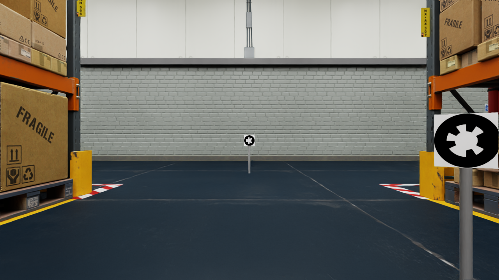
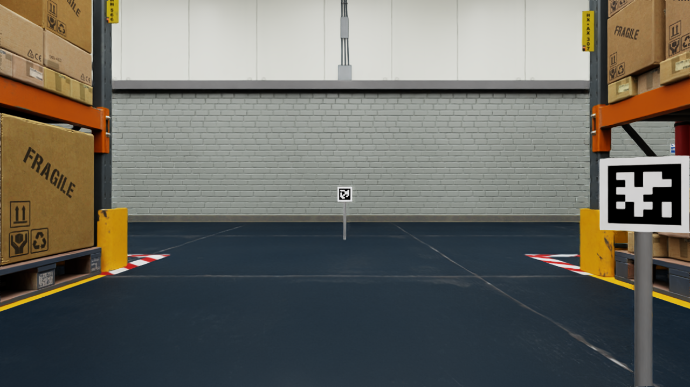
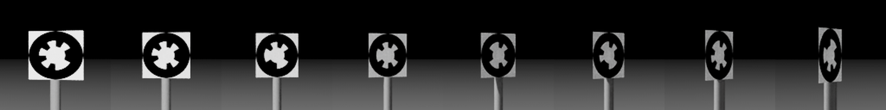

# whycode_sim

Isaac Sim warehouse scene for benchmarking WhyCode and AprilTag detection. A Nova Carter drives a
fixed loop between the racks past fiducial markers, and the camera stream, odometry and exact
ground-truth marker poses are recorded to a bag that detector variants are replayed against.

| WhyCode | AprilTag |
|---|---|
|  |  |

- `/marker_ground_truth` gives each marker's pose in the detector's own camera frame, so scoring
  is a subtraction.
- `marker.family: whycode | apriltag` swaps the printed pattern and nothing else: path, poses,
  speeds and lighting stay identical.

## Quick start

On the host, from the bench repo:

```bash
./scripts/manage.sh start            # ROS container
./scripts/manage.sh exec
```

In the ROS container:

```bash
colcon build --symlink-install --packages-select whycode_sim_msgs whycode_sim
source install/setup.bash
```

Then start Isaac from the host. It loads the message package built above, and its first start
streams about 20 GB of assets (20-40 min).

```bash
./scripts/manage.sh start isaac
```

## Record a bag

```bash
S=src/whycode_sim/whycode_sim/scripts
python3 $S/check_camera.py
ros2 launch whycode_sim sim.launch.py record:=true bag_prefix:=/root/data/raw_loop
python3 $S/retime_bag.py /root/data/raw_loop /root/data/loop
python3 $S/check_bag.py /root/data/loop --laps 1 && rm -rf /root/data/raw_loop
```

- The robot spawns facing the path, holds for `path.start_delay_s`, drives `laps` laps
  (default 1) and stops at the spawn; the launch then ends and the bag is finalised. `laps:=0`
  drives until stopped, and `laps:=3 lap_speeds:=0.5,0.8,1.2` gives each lap its own speed.
- The recorder logs on sim time and `retime_bag.py` takes each log time from the header stamp,
  so frames replay exactly 1/30 s apart. `check_bag.py` fails a bag with uneven log times, black
  or frozen frames, frames without ground truth, a partial lap, or two visible markers sharing
  an id.

Another scene goes to both halves. `manage.sh` sources `.env`, whose `SCENE_CONFIG` would win,
so start Isaac with Compose:

```bash
SCENE=/root/workspace/src/whycode_sim/whycode_sim/config/scene_B.yaml
SCENE_CONFIG=$SCENE docker compose --profile isaac up -d --force-recreate isaac        # host
ros2 launch whycode_sim sim.launch.py record:=true scene_config:=$SCENE bag_prefix:=/root/data/raw_loop
```

## Paths and bags

Only two aisles are clear end to end (x = -4.85 and 0.05); the others are cut by floor-level
cross-members. `scene_B.yaml` and `scene_C.yaml` `extends: scene.yaml` and hold only their path
and markers.

| Scene | Path | Lap | Markers |
|---|---|---|---|
| `scene.yaml` | A: both clear aisles, turning just past the rack ends | 47.7 m | 13 |
| `scene_B.yaml` | A plus a sweep west along the rack fronts | 72.4 m | 17 |
| `scene_C.yaml` | A plus sweeps west and east along the rack fronts | 94.0 m | 22 |

Recorded with Isaac Sim 6.2.0.1 at 1280x720 and 30 Hz:

| Bag | Path | Laps | Speed |
|---|---|---|---|
| `whycode_1lap`, `apriltag_1lap` | A | 1 | 0.8 m/s |
| `whycode_3lap_speeds`, `apriltag_3lap_speeds` | A | 3 | 0.5, 0.8, 1.2 m/s |
| `whycode_B_1lap`, `apriltag_B_1lap` | B | 1 | 0.8 m/s |
| `whycode_C_1lap`, `apriltag_C_1lap` | C | 1 | 0.8 m/s |

## Replay

Run `./scripts/manage.sh clean` on the host first. It stops the sim and any player: a second
`/clock` source makes RViz flicker and crash, which looks like a corrupt bag. Then:

```bash
ros2 launch whycode_sim replay.launch.py bag:=/root/data/whycode_1lap
```

Arguments: `bag`, `rate` (1.0), `loop` (true; each restart resets RViz), `rviz` (true),
`marker_size_m` (0.2).

Plates are coloured by visibility: green visible, grey out of frame, red occluded, purple too
oblique, yellow too few pixels. Labels read `id<N> <range>m <pixels>px <angle>deg`. In the
Camera display, green plates sit on the printed markers.

## Configuration

`config/scene.yaml` drives the scene builder, the ground-truth node and the waypoint follower,
so placement is computed once.

| Key | Controls |
|---|---|
| `camera.*` | Resolution, rate, field of view, mount, body and optical frame ids |
| `marker.family` | `whycode` or `apriltag` |
| `marker.size_m` | Edge length; must match `detector.outer_diameter` in `whycode_vision` |
| `marker.facing_angle_deg` | Incidence a robot sees on approach |
| `marker.emissive_intensity` | Brightness; RTX emission is physical, so values are in the hundreds |
| `visibility.*` | Thresholds for the `visible` flag |
| `path.*` | Waypoints, speed, start hold, lookahead, yaw-rate limit |
| `markers` | Placement along the path, or an explicit pose |

A family supplies nine ids. An entry with `slot` reuses one, which is valid only while the two
markers are never in frame together: `run_sim.py --verify-path` checks it and must report zero.

`config/scene_facing_test.yaml` renders one marker per incidence, 0 to 70 deg. Facing is set to
30, where the pattern is still crisp:



## Tools

`run_sim.py` options, on the host via `docker compose --profile isaac run --rm isaac <option>`:

| Option | Does |
|---|---|
| `--verify-path [--save-map NPZ]` | Clearance, predicted visibility and the shared-id check |
| `--survey`, `--suggest-markers N` | Occupancy map, loop between shelves, marker placements |
| `--introspect`, `--probe-nodes` | Robot joints and intrinsics; OmniGraph attribute names |

In `scripts/`, from the ROS container:

| Script | Does |
|---|---|
| `draw_loop_map.py` | Floor plan with the path, markers and a bag's driven trajectory |
| `compare_gt.py` | Detection rate and per-axis pose error against ground truth |

## Topics

| Topic | Type | Frame |
|---|---|---|
| `/camera/image_raw` | `sensor_msgs/Image` (rgb8) | `camera_optical_frame` |
| `/camera/camera_info` | `sensor_msgs/CameraInfo` | `camera_optical_frame` |
| `/marker_ground_truth` | `whycode_sim_msgs/MarkerGroundTruthArray` | `camera_link` |
| `/marker_occlusion` | `whycode_sim_msgs/MarkerOcclusion` | `camera_link` |
| `/camera_ground_truth` | `nav_msgs/Odometry` | `World` to `camera_link` |
| `/odom_ground_truth` | `nav_msgs/Odometry` | `odom` (= `World`) to `base_link` |
| `/tf`, `/tf_static`, `/clock` | | |
| `/cmd_vel` (in) | `geometry_msgs/Twist` | |

`camera_link` is the body frame (X forward, Y left, Z up) the detector reports in, and
`camera_optical_frame` the image's (Z forward, X right, Y down). `/marker_ground_truth` carries
every marker every frame with range, incidence, apparent size and visibility flags, so a miss
can be told from a marker that was never in view.

## Gotchas

- Ground-truth ids are what the detector reports: `whycode_N.png` decodes to N, an AprilTag
  to its filename number.
- `render.antialiasing` stays `DLAA` or `Off`. DLSS ghosts small moving markers while the
  frames still look fine.
- Both containers need the same `ROS_DOMAIN_ID`.
- A killed recorder leaves no `metadata.yaml`. Once the writer has stopped,
  `ros2 bag reindex <bag>` rebuilds it.
- `ros2 topic hz /camera/image_raw` cannot keep up with 2.8 MB images and under-reads the rate.
- Bags are MCAP with zstd chunks (`config/mcap_zstd.yaml`), about 2.6 GB per lap of path A.
